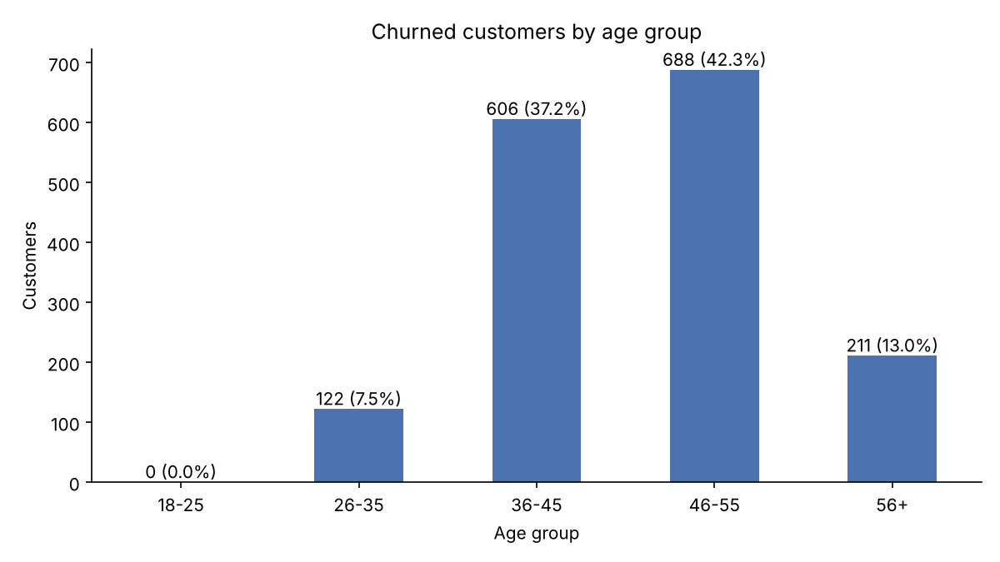
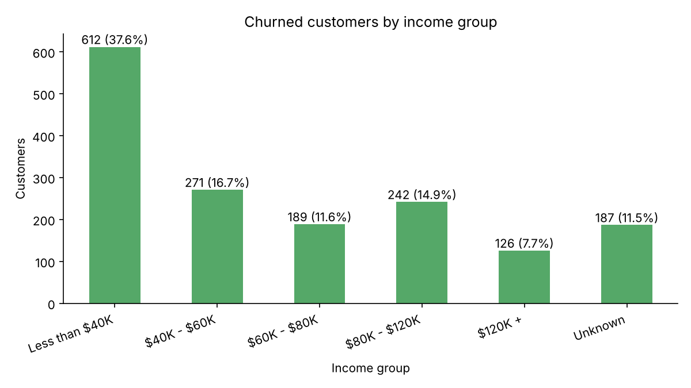
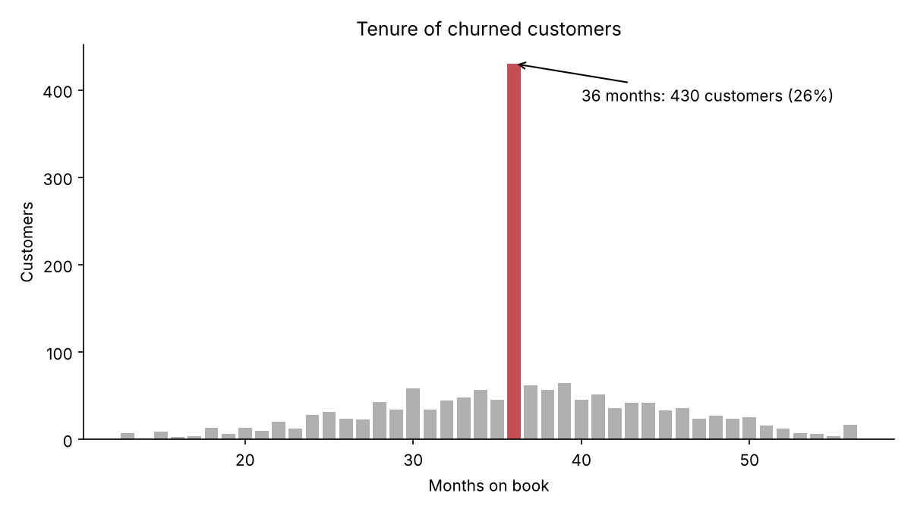

# Bank Churn Analysis – SQL Project

**Author:** Utkarsh Singh  
**Tools Used:** SQL (MySQL), Python (pandas, matplotlib), Visual Studio  

---

## Introduction

This SQL-based project analyzes churned bank customers using demographic and financial data. The purpose is to identify key trends, behavioral patterns, and risk segments associated with customer churn. Insights derived from this project help inform customer retention strategies and product improvements.

---

## Objective

The goal is to build a comprehensive SQL-driven backend to explore **why customers leave** the bank. Through a series of structured queries, the analysis uncovers churn trends across age, income, card usage, tenure, and demographic factors.

---

##  Dataset Overview

The dataset `bank_churn_data.csv` includes **1,627 records** representing **only churned customers**.

**Source:** Kaggle "Credit Card Customers" (BankChurners) dataset, filtered to attrited customers.  
**Limitation:** The data contains only churned customers, so this analysis profiles leavers but cannot calculate churn rate per segment. Next step: add retained customers and compare.  

| Column Name         | Description                                      |
|---------------------|--------------------------------------------------|
| clientnum           | Unique client identifier                         |
| customer_age        | Age of the customer                              |
| gender              | Gender of the customer                           |
| dependent_count     | Number of dependents                             |
| education_level     | Educational background                           |
| marital_status      | Marital status                                   |
| income              | Income category                                  |
| card_category       | Type of credit card held                         |
| months_on_book      | Duration as a client (in months)                 |
| credit_limit        | Credit limit assigned to the customer            |
| utilization_ratio   | Ratio of utilized credit to credit limit         |
| balance             | Current account balance                          |
| churn               | Indicates if the client churned (all = Yes)      |

---
##  Core Questions Answered
1. What are the average financial metrics (e.g., credit limit, utilization ratio, age)?
2. Which card categories and income groups make up most churned customers?
3. How long do customers typically stay before churning?
4. Which demographic groups (gender, age, marital status) make up most churned customers?
5. How does credit utilization differ among churned clients?

---

##  SQL Queries and Analysis

### 1. Total Customers, Age, Credit & Utilization
```sql
SELECT 
        COUNT(clientnum), 
        ROUND(AVG(customer_age)), 
        ROUND(AVG(credit_limit), 2), 
        ROUND(AVG(utilization_ratio), 2) 
FROM bank_churn_data;
```


Key Insight:
- Total Customers: 1,627
- Average Age: 47 years
- Average Credit Limit: $8,136.04
- Average Utilization Ratio: 16.0%

### 2. Average Balance and Credit by Income Group
```sql

SELECT 
    income, 
    AVG(balance) AS avg_balance, 
    AVG(credit_limit) AS avg_credit_limit 
FROM bank_churn_data 
GROUP BY income
ORDER BY avg_balance DESC;
```


Key Insight: Customers earning $80K–$120K have the highest average balance (~$759), while the $120K+ group has the highest average credit limit (~$19.7K). Credit limits rise steadily with income, but balances are similar across groups.

### 3. Utilization Distribution Categories
``` SQL 
SELECT 
    CASE 
        WHEN utilization_ratio < 0.2 THEN 'Low (0-20%)'
        WHEN utilization_ratio BETWEEN 0.2 AND 0.5 THEN 'Moderate (20-50%)'
        ELSE 'High (50%+)' 
    END AS utilization_category,
    COUNT(*) AS total_customers
FROM bank_churn_data
GROUP BY 
    CASE 
        WHEN utilization_ratio < 0.2 THEN 'Low (0-20%)'
        WHEN utilization_ratio BETWEEN 0.2 AND 0.5 THEN 'Moderate (20-50%)'
        ELSE 'High (50%+)' 
    END;
```


Key Insight: 73.1% of churned customers had low credit utilization (0–20%), indicating churn may be driven by lack of engagement, not debt pressure.

### 4. Top 10 Customers by Utilization
```SQL 
SELECT 
    clientnum, 
    customer_age, 
    income, 
    credit_limit, 
    ROUND(utilization_ratio, 3) AS utilization_ratio
FROM bank_churn_data
ORDER BY utilization_ratio DESC
LIMIT 10;
```


### 5. Gender-Based Financial Behavior
```sql
SELECT 
    gender, 
    COUNT(*) AS total_customers, 
    ROUND(AVG(balance), 2) AS avg_balance, 
    ROUND(AVG(utilization_ratio), 2) AS avg_utilization_ratio
FROM bank_churn_data 
GROUP BY gender 
ORDER BY gender;
```


Key Insight:
- Female customers: 57.2% of churned clients
- Their average utilization is higher than males (about 20% vs 11%).

### 6. Card Category and Churn Volume
```sql

SELECT 
    card_category, 
    COUNT(clientnum) AS number_of_customers, 
    ROUND(AVG(balance), 2) AS avg_balance, 
    ROUND(AVG(utilization_ratio), 2) AS avg_utilization_ratio
FROM bank_churn_data 
GROUP BY card_category 
ORDER BY number_of_customers DESC;
``` 


Key Insight:
- Blue cardholders: 93% of churned clients
- Note: this may simply reflect that most customers hold Blue cards. Churn rate per card type needs retained customers to compare.

### 7. Average Balance by Income Group
```sql
-- Average Bank Balance by Income Level
SELECT 
    income, 
    ROUND(AVG(balance)) AS average_balance 
FROM bank_churn_data 
GROUP BY income 
ORDER BY average_balance DESC;
```


Key Insight: Balances are similar across income groups (roughly $570–$760).

### 8. Marital Status Distribution
```sql
SELECT 
    marital_status, 
    COUNT(clientnum) AS number_of_customers 
FROM bank_churn_data 
GROUP BY marital_status 
ORDER BY number_of_customers DESC;

```


Key Insight: 
- Married customers: 43.6% of churned users; single customers: 41.1%.
- The two groups are close, so marital status is a weak signal.


### 9. Customer Tenure (Months on Book)
```sql
SELECT 
    months_on_book, 
    COUNT(*) AS total_customers 
FROM bank_churn_data 
GROUP BY months_on_book 
ORDER BY months_on_book DESC;
``` 


Key Insight:
- Churn spikes at exactly 36 months: 430 of 1,627 customers (26%).
- Indicates a critical drop-off point at the 3-year mark.

### 10. Average Tenure by Income Group
```sql
SELECT 
    income, 
    COUNT(*) AS total_churned, 
    ROUND(AVG(months_on_book), 2) AS avg_tenure_before_churn
FROM bank_churn_data 
GROUP BY income 
ORDER BY avg_tenure_before_churn ASC;
```


Key Insight:
- All income groups stay about 36 months on average (range 35.8–36.9)
- Income does not meaningfully change how long customers stay.

### 11.Age Group Segmentation
``` sql 
SELECT 
    age_group, 
    COUNT(*) AS number_of_customers
FROM (
    SELECT 
        CASE
            WHEN customer_age BETWEEN 18 AND 25 THEN '18-25'
            WHEN customer_age BETWEEN 26 AND 35 THEN '26-35'
            WHEN customer_age BETWEEN 36 AND 45 THEN '36-45'
            WHEN customer_age BETWEEN 46 AND 55 THEN '46-55'
            ELSE '56+' 
        END AS age_group
    FROM bank_churn_data
) AS age_groups
GROUP BY age_group
ORDER BY number_of_customers DESC;
```


Insight:

| Age Group | % of Churned Customers |
|-----------|------------------------|
| 46–55     | 42.3%                  |
| 36–45     | 37.2%                  |
| 56+       | 13.0%                  |
| 26–35     | 7.5%                   |
| 18–25     | 0%                     |

- Customers aged 36–55 make up about 80% of churners and should be the retention priority.

---

##  Python Charts

The notebook [`Bank_Churn_Charts.ipynb`](Bank_Churn_Charts.ipynb) adds three charts to the SQL analysis. It reads `bank_churn_data.csv` and checks its summary numbers against the SQL results.

### Churned customers by age group


The 46–55 group is the largest (688 customers, 42.3%). Ages 36–55 together are about 80% of churners.

### Churned customers by income group


"Less than $40K" is the largest group (612 customers, 37.6%). This is a share of churners, not a churn rate.

### Tenure of churned customers


Churn spikes at exactly 36 months: 430 customers (26%).

---

##  Key Insights Summary

| Insight Area           | Findings                                                  |
|------------------------|-----------------------------------------------------------|
| Utilization Ratio      | 73.1% of churned customers had low utilization (<20%)     |
| Credit Limit           | Average credit limit = $8,136.04                          |
| Tenure Risk            | Spike at 36 months (26% of churners)                      |
| Blue Card Impact       | 93% of churned clients used the basic Blue card           |
| Demographics           | 57.2% female, 43.6% married among churned clients         |
| Age Risk Zone          | 46–55 age group = largest share of churners (42.3%)       |

---

###  Key Metrics

- **Total Churned Clients:** 1,627  
- **Average Age:** 47 years  
- **Average Credit Limit:** $8,136.04  
- **Average Utilization Ratio:** 16.0%

###  Financial Behavior

- **73.1%** of customers used **less than 20%** of their credit (Low Utilization)
- Churn isn't always due to financial stress—**inactivity may be the cause**
- Higher-income clients have larger credit limits, but balances are similar across income groups

###  Card Category Insights

- **Blue Card** holders account for **93% of churned customers**
- Silver, Gold and Platinum holders make up 6.6% of churned customers

###  Demographics

- **57.2%** of churned users were **female**
- **43.6%** were **married**
- The **46–55 age group** is the largest segment (42.3%)

### Tenure Analysis

- Churn spikes at **36 months** of customer relationship
- Income groups show similar tenure (35.8–36.9 months)

This SQL-based analysis provides actionable insights into customer churn behavior.

---

##  Recommendations

- **Review Blue card benefits** and engagement (Blue is the largest card segment among churners)  
- **Introduce re-engagement campaigns** before the 36-month mark  
- **Target 36–55 age group** with tailored retention strategies  
- **Monitor low utilization** as an early signal for churn risk  
- **Strengthen engagement in years 2–3**, since most churners leave around month 36
